<p align="center">
  <picture>
    <source media="(prefers-color-scheme: dark)" srcset="docs/images/banner-dark.svg">
    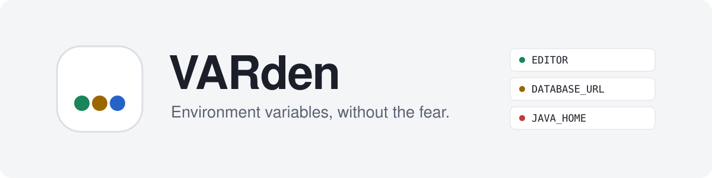
  </picture>
</p>

<p align="center">
  <b>A desktop app for your environment variables.</b><br>
  See them all in one place, fix broken ones, edit PATH safely, and update open terminals without restarting them.
</p>

<p align="center">
  <a href="https://github.com/RamezCh/VARden/actions/workflows/ci.yml"></a>
  
  
  
  
</p>

<p align="center">
  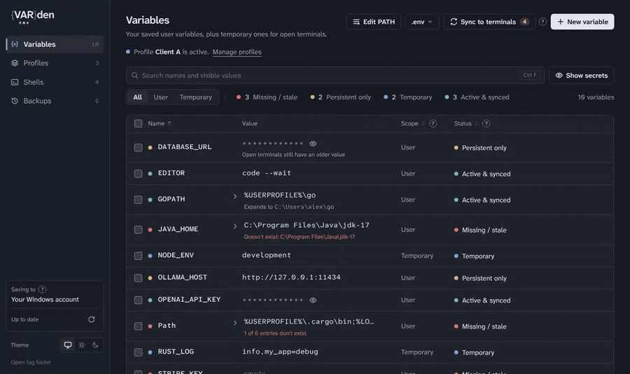
</p>

---

## Contents

- [What are environment variables?](#what-are-environment-variables)
- [Why VARden?](#why-varden)
- [Features](#features)
- [How it works](#how-it-works)
- [Install](#install)
- [Quick start](#quick-start)
- [VARden compared](#varden-compared)
- [FAQ](#faq)
- [Roadmap](#roadmap) · [Developing](#developing)

## What are environment variables?

Environment variables are named settings that every program can read when it starts: `PATH` (where to find programs), `JAVA_HOME` (which Java to use), `OPENAI_API_KEY` (a key your scripts read instead of having it pasted into code). Installers, SDKs and tutorials constantly ask you to "add this to your environment".

The trouble is that they're scattered and invisible:

- **On Windows** they live in the registry, behind a small dialog several clicks deep, in one long `;`-separated line.
- **On macOS and Linux** they're `export` lines spread across `.bashrc`, `.zshrc`, `config.fish` and friends.
- **Terminals that are already open never notice changes.** You change a variable, run your command, and it still uses the old value until you close the terminal.
- **Nothing tells you when one is broken**, for example `JAVA_HOME` pointing to a JDK you uninstalled last year, or a `PATH` folder that no longer exists.
- **One wrong edit to `PATH`** and commands stop working, with no undo.

## Why VARden?

|  |  |
|---|---|
| 🛡️ **Safe by design** | Only *your* variables are ever changed, never system ones, so it never needs admin rights. Every change is backed up first and has an **Undo**. |
| 🔍 **Finds what's broken** | Values that point to folders or files that don't exist are flagged, including each folder in `PATH`. |
| ⚡ **No more "restart your terminal"** | One click pushes changes into terminals that are already open: PowerShell, Git Bash, bash, zsh and fish. |
| 🧭 **A PATH editor you can trust** | Add, remove and reorder your folders in a list. The system part is read-only, and you review every change before it's saved. |
| 🔐 **Secrets stay hidden** | API keys and passwords are masked on screen, can be copied without being shown, and can't be found by typing guesses into search. |
| 🗂️ **Profiles and `.env` files** | Switch a whole set of variables per client or project in one click, and import or export `.env` files. |

## Features

### See everything, at a glance

Every variable you've set, with a status that tells you whether it works and whether your terminals have it yet.

<picture>
  <source media="(prefers-color-scheme: dark)" srcset="docs/images/variables-dark.png">
  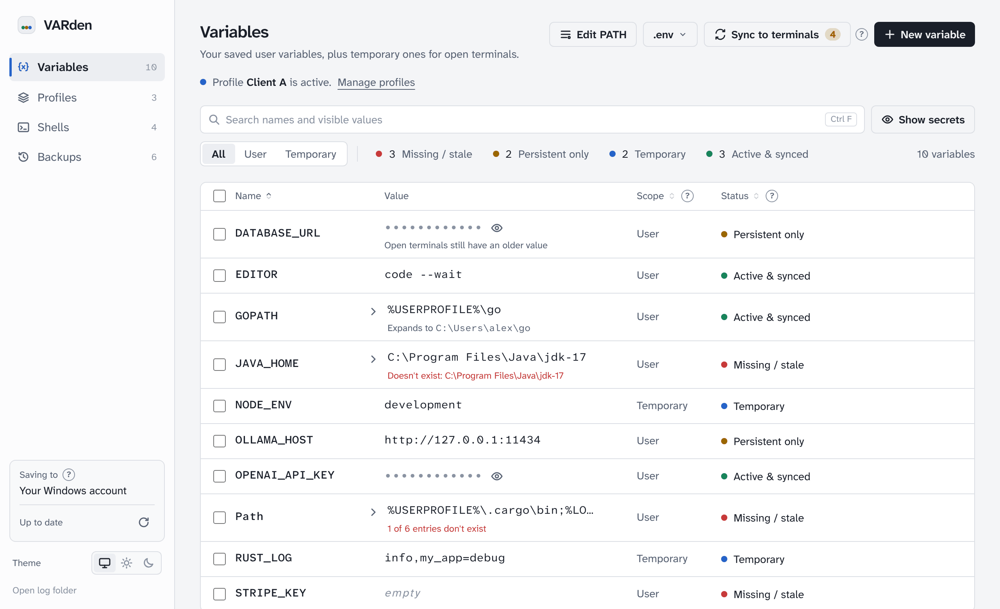
</picture>

| Status | Meaning | What to do |
|---|---|---|
| 🟢 **Active & synced** | Saved, and the environment that's running already has it. | Nothing. |
| 🟡 **Persistent only** | Saved, but terminals that were already open don't have it yet. New ones do. | Click **Sync to terminals**, or open a new terminal. |
| 🔵 **Temporary** | Only pushed into open terminals and never saved. Handy for a quick test. | Edit it and choose **User** to keep it. |
| 🔴 **Missing / stale** | Empty, or points to a folder or file that doesn't exist. | Fix the value, or delete it. |

### Read long values, and spot the broken part

`PATH` and other long values open right in the table, one folder per line, with folders that don't exist marked in red.

<picture>
  <source media="(prefers-color-scheme: dark)" srcset="docs/images/long-values-dark.png">
  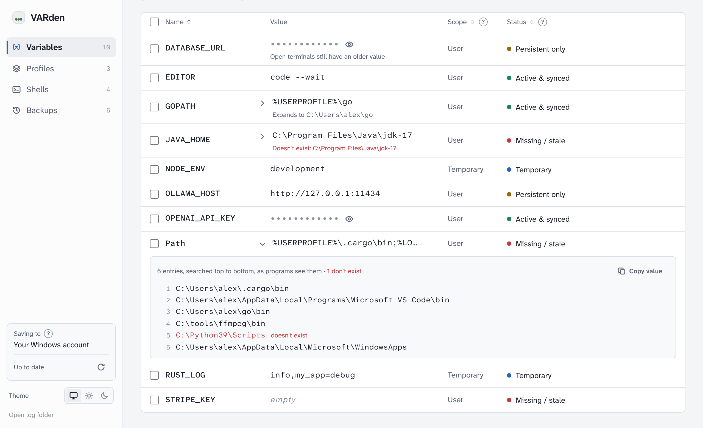
</picture>

### Edit PATH without fear

Your folders are a list you can edit, reorder and check as you type. The system part of PATH is shown but locked. Before anything is saved you see exactly what changes, and a backup is taken first.

<table>
  <tr>
    <td width="50%">
      <picture>
        <source media="(prefers-color-scheme: dark)" srcset="docs/images/path-editor-dark.png">
        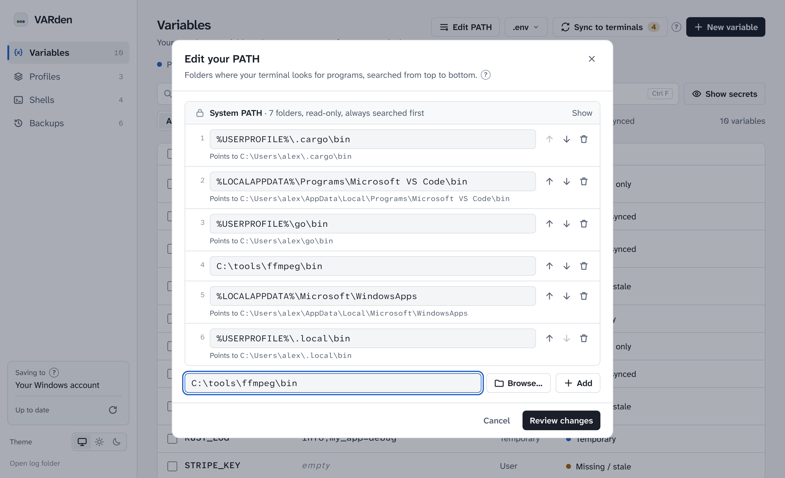
      </picture>
    </td>
    <td width="50%">
      <picture>
        <source media="(prefers-color-scheme: dark)" srcset="docs/images/path-review-dark.png">
        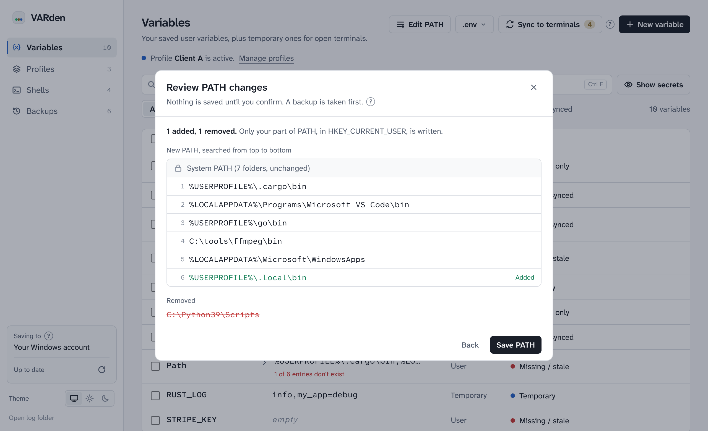
      </picture>
    </td>
  </tr>
  <tr>
    <td align="center"><sub>Edit: missing folders, duplicates and what <code>%VAR%</code> points to are shown as you type.</sub></td>
    <td align="center"><sub>Review: nothing is saved until you confirm.</sub></td>
  </tr>
</table>

### Profiles, shells and backups

<table>
  <tr>
    <td width="33%">
      <picture>
        <source media="(prefers-color-scheme: dark)" srcset="docs/images/profiles-dark.png">
        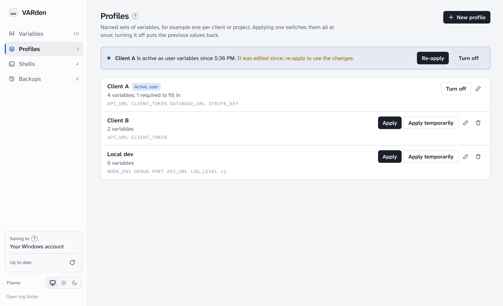
      </picture>
    </td>
    <td width="33%">
      <picture>
        <source media="(prefers-color-scheme: dark)" srcset="docs/images/shells-dark.png">
        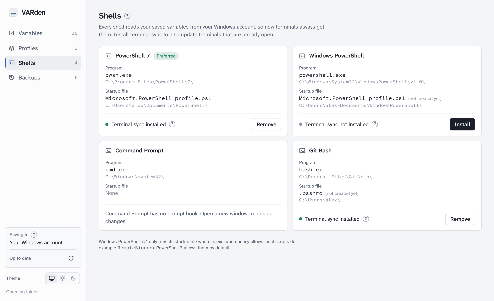
      </picture>
    </td>
    <td width="33%">
      <picture>
        <source media="(prefers-color-scheme: dark)" srcset="docs/images/backups-dark.png">
        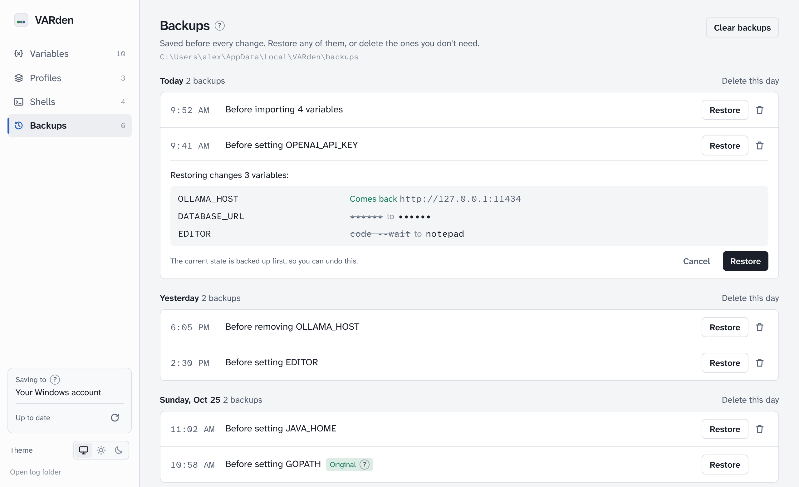
      </picture>
    </td>
  </tr>
  <tr>
    <td align="center"><sub><b>Profiles</b>: switch a whole set of variables per client or project. Turning one off puts your previous values back.</sub></td>
    <td align="center"><sub><b>Shells</b>: every shell VARden found, and one-click terminal sync for each.</sub></td>
    <td align="center"><sub><b>Backups</b>: taken before every change. See what a restore would do before you confirm.</sub></td>
  </tr>
</table>

### Everything else

- **`.env` import and export.** Drop a `.env` file on the window to import it: you see what's new, what would be replaced, and what can't be read, before anything is written. Export any selection to a `.env` file, with your last five export folders one click away.
- **Rename and bulk actions.** Rename a variable in place; select several to export or delete together.
- **Changes from elsewhere show up on their own.** Changes from `setx`, the Windows dialog or an editor saving `.zshrc` appear without a refresh.
- **Light and dark themes** that follow your system, plus keyboard shortcuts: <kbd>Ctrl</kbd>+<kbd>F</kbd> search, <kbd>Ctrl</kbd>+<kbd>N</kbd> new variable, <kbd>Ctrl</kbd>+<kbd>1</kbd>–<kbd>4</kbd> switch pages, <kbd>Del</kbd> delete selected, <kbd>F5</kbd> reload.
- **Help where you need it.** A small **?** next to every term that might be new explains it in plain words.

## How it works

### Where your variables live

VARden only ever writes to places that belong to your user account. Programs read from the same places they always have, so VARden doesn't need to be running for your variables to work.

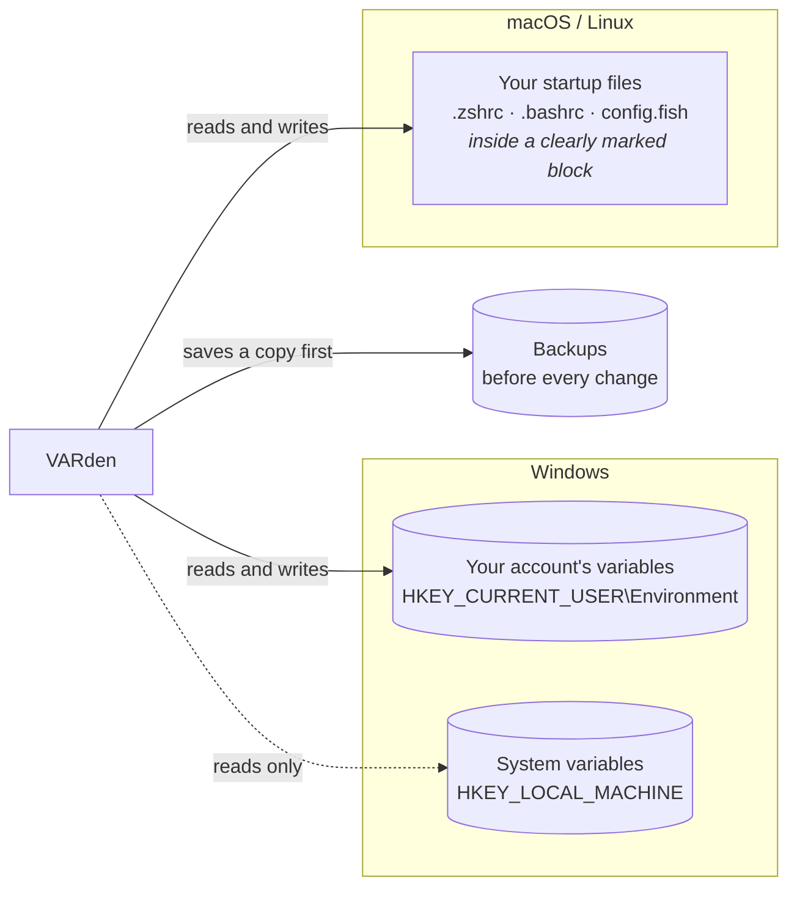

On macOS and Linux, VARden only edits lines between two markers in your startup file, and leaves everything else exactly as it was:

```bash
# >>> VARDEN MANAGED BLOCK >>>
# Managed by VARden. Manual edits inside this block may be overwritten.
export OPENAI_API_KEY='sk-...'
export PATH="$HOME/.local/bin:$PATH"
# <<< END VARDEN MANAGED BLOCK <<<
```

### Updating terminals that are already open

Programs read environment variables once, when they start. That's why an open terminal never sees a change, and why tutorials say "restart your terminal". VARden solves this with a tiny hook you can install per shell from the **Shells** page:

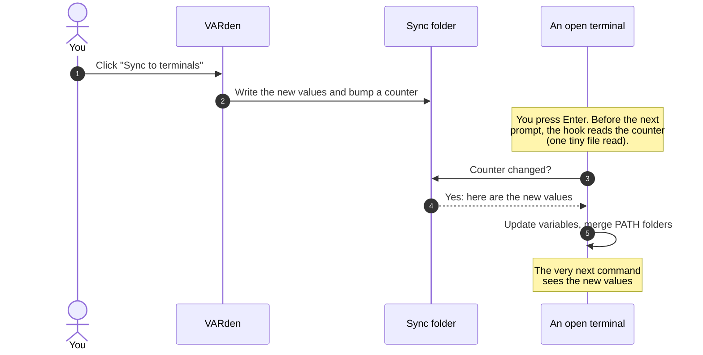

The hook is a few lines added to the shell's profile (backed up first) and can be removed with one click. Your activated virtualenv or conda environment survives a sync, because PATH is merged folder by folder rather than replaced.

### What happens when you change something

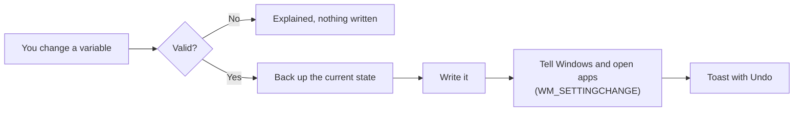

## Install

> [!NOTE]
> Ready-made installers for Windows, macOS and Linux arrive with the next release (see the [Roadmap](ROADMAP.md)). Until then, VARden is built from source, which takes a few minutes.

1. Install [Rust](https://rustup.rs) and [Node.js 20+](https://nodejs.org). On Windows you also need the [Visual Studio C++ Build Tools](https://visualstudio.microsoft.com/visual-cpp-build-tools/) ("Desktop development with C++"). On Linux you need the [Tauri system packages](https://tauri.app/start/prerequisites/#linux).
2. Build and run:

   ```bash
   git clone https://github.com/RamezCh/VARden.git
   cd VARden
   npm install
   npm run tauri dev      # run it
   npm run tauri build    # or build an installer into target/release/bundle
   ```

## Quick start

1. **Open VARden.** The **Variables** page lists everything you've set for your account. Anything 🔴 needs a look.
2. **Add a variable** with **New variable** (<kbd>Ctrl</kbd>+<kbd>N</kbd>). Choose **User** to keep it, or **Temporary** to try it in open terminals only.
3. **Set up terminal sync once.** Go to **Shells** and click **Install** next to the shells you use. Open a new terminal so it picks up the hook.
4. **Sync.** From now on, after a change, click **Sync to terminals** and your open terminals have it at their next prompt.
5. **Made a mistake?** Click **Undo** on the notice, or restore any earlier state from **Backups**.

## VARden compared

How VARden compares with the tools you'd otherwise use:

|  | **VARden** | Windows "Environment Variables" dialog | `setx` | Editing `.bashrc` / `.zshrc` by hand |
|---|:---:|:---:|:---:|:---:|
| See every variable at once | ✅ | ✅ | ❌ | ❌ |
| Backup and undo for every change | ✅ | ❌ | ❌ | ❌ |
| Flags values that point to missing folders | ✅ | ❌ | ❌ | ❌ |
| Updates terminals that are already open | ✅ | ❌ | ❌ | `source` in each terminal |
| PATH edited as a list, with a review step | ✅ | List, no review | ❌ ([cuts values at 1,024 characters](https://learn.microsoft.com/en-us/answers/questions/900933/setx-command-warning-the-data-being-saved-is-trunc)) | ❌ |
| Secrets masked on screen | ✅ | ❌ | ❌ | ❌ |
| Profiles per project or client | ✅ | ❌ | ❌ | ❌ |
| `.env` import and export | ✅ | ❌ | ❌ | ❌ |
| Works on Windows, macOS and Linux | ✅ | Windows | Windows | macOS / Linux |
| Needs admin rights | Never | For system variables | For `/M` | No |

## FAQ

<details>
<summary><b>Is it safe? Could VARden break my computer?</b></summary>

VARden only writes variables that belong to your user account. It never touches system-wide variables, so it can't affect other accounts or Windows itself, and it never asks for admin rights. Before every change it saves a backup, and every change has **Undo**. The very first backup of each place it writes to (your "original") is kept forever, so you can always go back to how things were before you installed VARden.
</details>

<details>
<summary><b>I changed a variable but my terminal still has the old value. Why?</b></summary>

Programs read environment variables once, when they start. That's how every operating system works, not a VARden quirk. You have two options:

- Open a new terminal, which always gets the new values.
- Install **terminal sync** for your shell on the **Shells** page. After that, **Sync to terminals** updates open terminals before their next prompt.

Other programs (your IDE, for example) need to be restarted to see changes.
</details>

<details>
<summary><b>What's the difference between User and Temporary?</b></summary>

**User** variables are saved for your account: every new terminal and program gets them, also after a restart. **Temporary** variables are never saved. They're pushed into open terminals when you sync, and they're gone when those terminals close. They're useful to try something out, or for values you don't want written to disk.
</details>

<details>
<summary><b>Why can't I edit system variables?</b></summary>

On purpose. System variables affect every account on the computer and need admin rights to change, so a mistake there is much harder to undo. VARden shows the system part of `PATH` read-only so you can see the whole picture, but it never writes it. If you really need to change a system variable, use the Windows dialog as an administrator.
</details>

<details>
<summary><b>Are my API keys stored securely?</b></summary>

VARden stores values exactly where your operating system expects them: the Windows registry, or your shell's startup file. That's the same place they'd be if you set them any other way, and it's what programs read. VARden doesn't add encryption, because programs couldn't read encrypted values. What it does add:

- Secrets are masked on screen and can be copied without being shown.
- Masked values can't be found by searching.
- The log file records variable *names*, never values.
- Nothing is ever sent over the network.
</details>

<details>
<summary><b>Why is a variable marked 🔴 "Missing / stale" when it looks fine?</b></summary>

Either its value is empty, or it points to a folder or file that doesn't exist on this computer. Open the row (the ▸ arrow) to see exactly which part is missing. Common causes are an uninstalled SDK, a version number that changed after an update (`jdk-17` vs `jdk-17.0.2`), or a typo. URLs, relative paths and network shares are never checked, so they're never flagged.
</details>

<details>
<summary><b>Does it work with Command Prompt, WSL, IDEs and Docker?</b></summary>

- **Command Prompt** gets your variables in every new window, but has no hook for updating windows that are already open.
- **IDEs and other apps** get your variables when they start. Restart them after a change.
- **WSL** keeps its own Linux environment. Windows variables only reach it when you list them in `WSLENV`.
- **Docker containers** don't inherit your variables unless you pass them with `-e` or `--env-file`. VARden's `.env` export is handy for that.
</details>

<details>
<summary><b>I edited my <code>.zshrc</code> by hand. Will VARden overwrite it?</b></summary>

No. VARden only changes lines between its own markers and leaves everything else in the file untouched, including line endings and file permissions. If you edit inside the block by hand, VARden keeps lines it can't fully understand exactly as written. If the markers themselves get damaged, VARden refuses to write to that file until it's fixed or restored from a backup.
</details>

<details>
<summary><b>What happens if I uninstall VARden?</b></summary>

Your variables stay. They live in your account and your startup files, not inside VARden. The uninstaller planned for the next release will also remove the terminal-sync hooks from your shell profiles. Until then, remove them on the **Shells** page before uninstalling.
</details>

<details>
<summary><b>Does VARden collect any data?</b></summary>

No. There's no telemetry, no account and no network access. Diagnostic logs stay on your computer (**Open log folder** in the sidebar) and contain variable names and actions, never values.
</details>

## Roadmap

VARden is built in stages. See [ROADMAP.md](ROADMAP.md) for the full list.

- [x] User and temporary variables, backups and undo, status checks
- [x] Terminal sync, `.env` import and export, restore preview
- [x] Broken-path detection, profiles, custom startup files
- [x] Safe PATH editor, rename, bulk actions, light and dark themes
- [ ] **Next:** installers, an uninstaller that cleans up hooks, auto-updates, a tray icon
- [ ] Launch: license and contributing guide

## Developing

VARden is a [Tauri 2](https://tauri.app) app: the core is plain Rust (`crates/envcore`, fully unit-tested, no UI), and the interface is React with Tailwind CSS. Every push is checked on Windows, macOS and Linux, including the terminal hooks in real bash, zsh, fish and PowerShell.

See **[docs/DEVELOPMENT.md](docs/DEVELOPMENT.md)** for the code layout, build steps, design decisions and the full command list.
